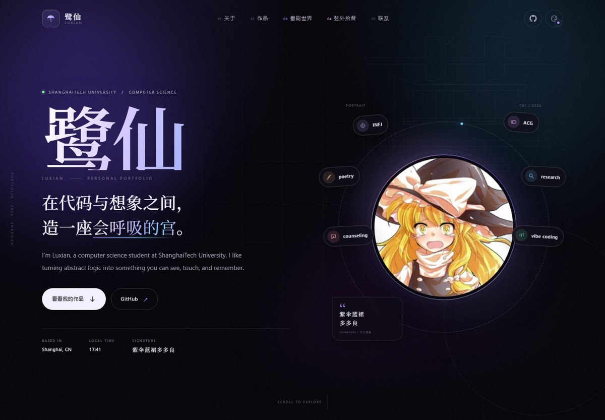
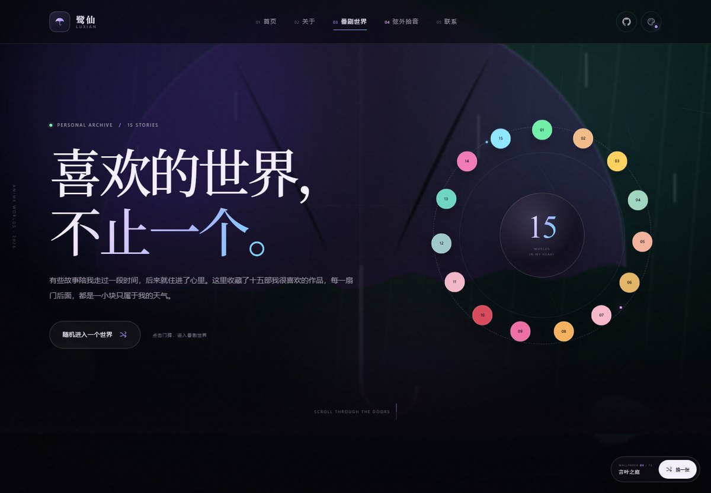
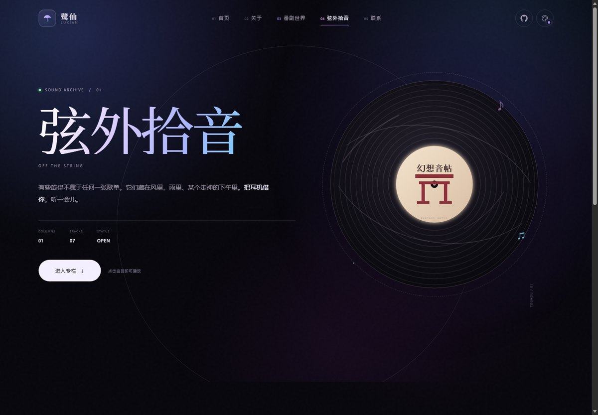

# 鹭仙 · Luxian 的个人主页

一个为 GitHub Pages 准备的多页个人网站。纯 HTML / CSS / JavaScript，零依赖、零构建，直接上传即可运行。



- 线上地址（部署后）：<https://luxian120.github.io/>
- 番剧世界：<https://luxian120.github.io/worlds.html>
- GitHub：<https://github.com/Luxian120>
- QQ：`3431982965`
- 邮箱：<taoran2025@shanghaitech.edu.cn>

## 页面内容

- **Hero**：姓名、上海科技大学计算机科学背景、个人签名与实时上海时间
- **About**：自我介绍、坐标 / 学校 / 方向 / 状态
- **Work**：课程项目《心之宫》，一个关于迷宫、追逐与自我接纳的游戏
- **番剧世界**：十五部喜欢的作品，可筛选、随机进入、查看详情与切换上一站 / 下一站
- **弦外拾音**：音乐分区，第一个专栏「幻想音帖」收录七首东方 Project 原曲，可在网页内直接播放
- **动态壁纸**：番剧世界页使用十五部作品的原创动态氛围壁纸，右下角按钮可随机切换
- **Contact**：GitHub、QQ、邮箱与学校链接
- **细节**：四种心情主题（晴 / 雨 / 夜 / 花）、响应式移动菜单、滚动进度、入场动画、头像视差

### 番剧世界



收藏了《FX战士久留美》《轻音少女》《宝可梦》《言叶之庭》《CLANNAD》《辉夜大小姐想让我告白》《百变小樱》《干物妹！小埋》《我的妹妹不可能那么可爱》《物语系列》《秒速五厘米》《败犬女主太多了》《命运石之门》《魔法少女小圆》《某科学的超电磁炮》。

- 点击任意门牌打开全屏世界详情
- 按「治愈 / 冒险 / 心动」筛选
- 随机进入一个世界
- 背景是十五部作品的原创动态氛围壁纸，右下角可随机切换；打开某个世界时，背景也会跟着切换
- 用 `←` `→` 键或底部按钮切换作品
- 支持通过 `worlds.html#world-fx` 这类链接直接打开某个世界
- 全部插画和动态壁纸为 CSS / SVG / Canvas 原创内容，不含动画截图或官方图片

### 弦外拾音



- 第一个专栏「幻想音帖」收录《飞翔于宇宙的不可思议巫女》《兔已着陆》《风神少女》《宇佐大人的白旗》《活泼纯情小姑娘的冒险》《广有射怪鸟事》《少女绮想曲》
- 点击专栏卡片打开播放面板，点击曲目或播放键即可试听
- 支持播放 / 暂停、进度拖动、静音、曲目时长与当前播放时间
- 音频文件放在 `assets/music/`，页面用原生 `<audio>` 播放，不依赖第三方播放器
- 七首 MP3 合计约 88 MB，使用按需加载：只有点击曲目后才开始下载音频
- 曲目版权归原作者与上海爱丽丝幻乐团所有，仅作个人收藏与试听

页面里的项目信息来自公开的 GitHub 主页与 `CS101H-` 仓库 README；番剧信息来自各作品公开资料；其余文案是可以自由改写的个人介绍。

## 本地预览

直接双击 `index.html` 即可。更推荐起一个本地静态服务器：

```powershell
python -m http.server 8000
```

然后访问 <http://127.0.0.1:8000/>。

## 发布到 GitHub Pages

GitHub Pages 的用户主页仓库必须命名为 **`Luxian120.github.io`**。

### 方式一：网页上传（最省事）

1. 在 GitHub 新建公开仓库 `Luxian120.github.io`，不要勾选初始化 README。
2. 把本目录中的以下内容上传到仓库根目录：
   - `index.html`
   - `worlds.html`
   - `music.html`
   - `404.html`
   - `styles.css`
   - `worlds.css`
   - `music.css`
   - `script.js`
   - `worlds.js`
   - `music.js`
   - `assets/`（整个文件夹，包含 `assets/music/`）
   - `robots.txt`、`sitemap.xml`
   - `.nojekyll`
3. 打开仓库的 **Settings → Pages**。
4. 在 **Build and deployment** 中选择 **Deploy from a branch**，Branch 选 `main`，目录选 `/ (root)`，保存。
5. 等 1–2 分钟，访问 <https://luxian120.github.io/>。

### 方式二：命令行

```powershell
git init
git add .
git commit -m "Build personal website"
git branch -M main
git remote add origin https://github.com/Luxian120/Luxian120.github.io.git
git push -u origin main
```

推送后同样在 **Settings → Pages** 里把来源设为 `main` / `/ (root)`。

## 想换成自己的内容

- **文字**：主页在 `index.html` 里，按区块搜索 `ABOUT`、`SELECTED WORK`、`SAY HELLO`。
- **番剧数据**：在 `worlds.js` 顶部的 `WORLDS` 对象中修改标题、年份、关键词、记忆碎片与配色；门牌卡片本身在 `worlds.html` 里。
- **番剧插画**：十五张 SVG 氛围图在 `worlds.html` 顶部 `<svg class="svg-sprite">` 中，按 `art-fx`、`art-kon` 等 ID 查找。
- **音乐**：专栏与曲目在 `music.html`，播放交互在 `music.js`；替换或新增音频时，把文件放进 `assets/music/`，再修改曲目按钮的 `data-src`、`data-title` 和 `data-artist`。
- **头像**：替换 `assets/avatar.jpg`（正方形图片最合适）。
- **主题色**：`styles.css` 顶部的 `:root`（夜）与 `[data-theme="day"]`、`[data-theme="rain"]`、`[data-theme="bloom"]` 变量。
- **项目卡片**：搜索 `project-card`，修改标题、描述、数据与 GitHub 链接。
- **分享封面**：`assets/og-cover.png` 是主页封面，`assets/og-worlds.png` 是番剧世界封面（建议 1200 × 630）。
- **换成真实番剧壁纸**：当前背景是原创 SVG 场景。若想换成自己的图片或 GIF，把文件放进 `assets/`，然后将 `worlds.js` 里 `slide.innerHTML` 的 `<svg>…</svg>` 替换为 ``；`.wallpaper-slide img` 的样式已经准备好。
- **统计数字**：`06`、`02`、`05` 分别对应 BOSS 阶段、游戏模式和普通关卡。

## 文件说明

```text
.
├── index.html          主页结构与文案
├── worlds.html         番剧世界画廊、SVG 插画与详情弹窗
├── music.html          弦外拾音、幻想音帖与音频播放面板
├── 404.html            自定义 404 页面
├── styles.css          主页样式、主题与响应式
├── worlds.css          番剧世界页面与弹窗样式
├── music.css           弦外拾音页面与播放面板样式
├── script.js           主题、菜单、滚动与入场动画
├── worlds.js           番剧数据、筛选、随机与弹窗交互
├── music.js            专栏弹层、曲目切换与音频播放控制
├── assets/
│   ├── avatar.jpg      GitHub 头像
│   ├── mark.svg        伞形标识 / favicon
│   ├── og-cover.png    主页社交分享封面
│   ├── og-worlds.png   番剧世界分享封面
│   ├── preview.jpg     主页 README 预览
│   ├── worlds-preview.jpg  番剧世界 README 预览
│   ├── music-preview.jpg   弦外拾音 README 预览
│   └── music/
│       ├── wind-goddess.mp3       风神少女 (Short Version)
│       ├── usagi-white-flag.mp3   宇佐大人的白旗
│       ├── otenba-adventure.mp3   活泼纯情小姑娘的冒险
│       ├── till-when.mp3          广有射怪鸟事 ～ Till When
│       ├── dream-battle.mp3       少女绮想曲 ～ Dream Battle
│       ├── cosmic-shrine-maiden.mp3 飞翔于宇宙的不可思议巫女
│       └── rabbit-landed.mp3      兔已着陆 ～ 兎は舞い降りた
├── robots.txt
├── sitemap.xml
├── .nojekyll           告诉 GitHub Pages 不要走 Jekyll
└── README.md
```

## 说明

- 站点不加载任何第三方字体、统计脚本、动画截图或外部依赖，离线也能完整显示；音频是本地的七首 MP3。
- 默认是「夜」主题；右上角色盘按钮可自由切换「晴 / 雨 / 夜 / 花」，选择会记录在浏览器本地。
- 四个主题分别对应暖金、雾蓝、午夜紫和玫瑰粉的配色，详情弹窗始终保持深色电影感。
- 如果之前保存过旧的深色 / 浅色选择，会自动迁移到「夜 / 晴」。
- 番剧详情弹窗使用原生 `<dialog>`，支持 Esc 关闭、焦点回到触发卡片和键盘方向键切换。
- 如果之后把项目拆成多个仓库，可以在 `index.html` 的 `project-extras` 前继续复制 `project-card` 结构。
